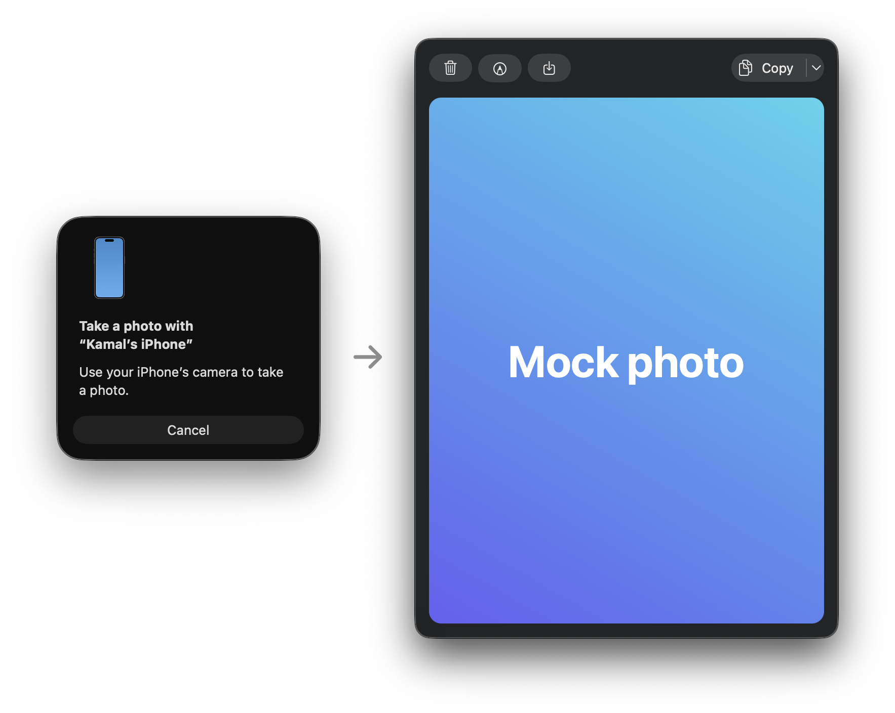

# iPhoneSnap.spoon

<p align="center">
  
</p>

A [Hammerspoon](https://www.hammerspoon.org) Spoon that puts Continuity Camera's "Take Photo" (Finder's **Import from iPhone**) on a hotkey. The photo opens in a preview where you can copy, save, edit or delete it.

Requires macOS 13+, Xcode Command Line Tools, and an iPhone set up for Continuity Camera.

## Install

Download `iPhoneSnap.spoon.zip` from the [latest release](https://github.com/kamaln7/iPhoneSnap.spoon/releases/latest), unzip it and double-click `iPhoneSnap.spoon`. Hammerspoon copies it to `~/.hammerspoon/Spoons/`.

That only installs it. The Spoon binds no hotkey on its own, so it does nothing until you load it.

## Set up

Add this to `~/.hammerspoon/init.lua` (Hammerspoon menu bar icon → **Open Config**), then choose **Reload Config**:

```lua
hs.loadSpoon("iPhoneSnap")
spoon.iPhoneSnap:bindHotkeys({ take = { { "shift" }, "f13" } }) -- pick any hotkey
```

Press the hotkey to take a photo. The first press compiles the helper, which takes a few seconds; it recompiles only when the Swift file changes.

Prefer a menu item or another trigger? Call `spoon.iPhoneSnap:take()` from it instead of binding a hotkey.

## Options

Optional. Set these in `init.lua` between `hs.loadSpoon` and `bindHotkeys`:

```lua
spoon.iPhoneSnap.saveDir = "~/Downloads"   -- where Save puts photos (default ~/Downloads)
spoon.iPhoneSnap.defaultAction = "copy"    -- what Return does: delete, edit, copy, save, saveCopy (default save)
spoon.iPhoneSnap.edit = function(path) hs.open(path) end -- what Edit does (default: open in the default app)
```

## Keys

Return runs the default. The shortcuts are ⌘C Copy, ⇧⌘S Save & Copy, ⌘S Save, ⌘E Edit and Esc Delete.

## Without an iPhone

```sh
~/.hammerspoon/Spoons/iPhoneSnap.spoon/iphone-snap --mock [photo.jpg] [--default copy] [--save-dir DIR]
```
